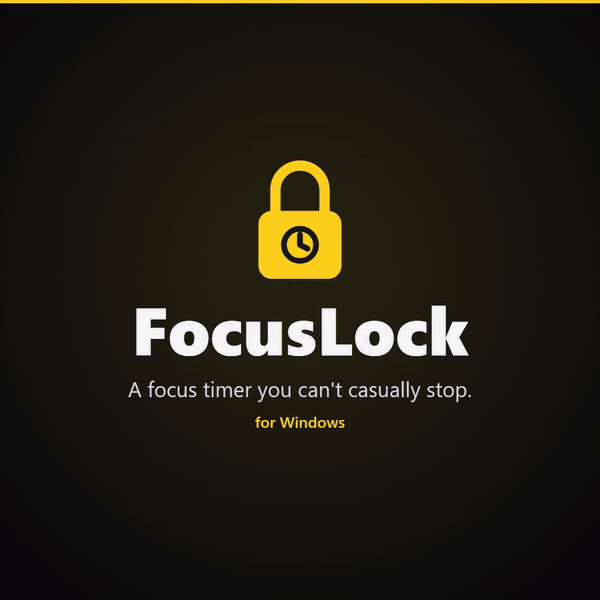

# FocusLock

FocusLock is a set of tools for one job: **making distractions hard to reach on every device you own**, so that staying focused doesn't depend on willpower in the moment.

It has two parts that work together:

| Part | What it does | When it's active | Where |
|---|---|---|---|
| **1. The focus timer** | You start a timed session ("50 minutes: fix the pagination bug"). Until it ends, it covers and closes distracting tabs, kills games, and uses an AI "judge" to decide whether a page is on task. | Only during a session you start | Windows and Linux laptops (`cmd/`, `internal/`, `app/`) |
| **2. The lockdown** | Always-on rules: adult sites filtered by DNS, YouTube/Instagram/Reddit/... blocked, other browsers and VPNs banned, no way to switch it off without admin rights or a key someone else holds. | All the time | Linux, Windows, Android phones and tablets, iPad, and the home router (`lockdown/`, `android/`) |

Think of it as layers, from the outside in:

```
 ┌──────────────────────────────────────────────────────────────────────────┐
 │ Layer 1  Home router (TP-Link)    every device on the Wi-Fi gets the     │
 │                                   CleanBrowsing adult-filter DNS         │
 │  ┌────────────────────────────────────────────────────────────────────┐  │
 │  │ Layer 2  Each device's own lockdown  (works on any network)        │  │
 │  │   Linux laptop    root systemd service      lockdown/linux/        │  │
 │  │   Windows laptop  SYSTEM scheduled task     lockdown/windows/      │  │
 │  │   Android         Device Owner app          android/               │  │
 │  │   iPad            supervised + profiles     lockdown/ios/          │  │
 │  │  ┌──────────────────────────────────────────────────────────────┐  │  │
 │  │  │ Layer 3  Focus timer session (laptops, when you start one)   │  │  │
 │  │  │   judges every tab and app against your task                 │  │  │
 │  │  └──────────────────────────────────────────────────────────────┘  │  │
 │  └────────────────────────────────────────────────────────────────────┘  │
 └──────────────────────────────────────────────────────────────────────────┘
```

Each layer covers a gap in the one outside it:
- The router can't stop a device from using its own DNS, and does nothing on mobile data.
- A device's lockdown can block known sites, but it can't tell a useful YouTube lecture from a time-wasting one.
- The focus timer can, but only while a session is running.

## Contents

- [Start here (new to the code?)](#start-here-new-to-the-code)
- [Repository map](#repository-map)
- **Part 1: [The focus timer](#part-1-the-focus-timer)** (Windows and Linux)
- **Part 2: [The lockdown](#part-2-the-lockdown)**: [shared rules](#the-shared-rule-files), [Linux](#linux-lockdown), [Windows](#windows-lockdown), [Android](#android-lockdown), [iPad](#ipad-lockdown), [router](#router-layer), [time budgets](#time-budgets-x-on-the-laptop), [undoing it](#undoing-the-lockdown), [known gaps](#known-gaps)
- [Working on the codebase](#working-on-the-codebase)

## Start here (new to the code?)

A few ideas come up everywhere in this repo. If they're new to you, read these first:

| Term | Meaning here |
|---|---|
| **DNS** | The phone book of the internet: it turns `youtube.com` into an IP address. If DNS refuses to answer, the site doesn't load. We use **CleanBrowsing's Adult filter** (`185.228.168.10`, `185.228.169.11`), a free DNS service that refuses to answer for adult sites. |
| **DoH / DoT** | DNS over HTTPS / TLS: encrypted DNS. Good for privacy, but a browser using its own DoH would skip our filter, so the lockdown turns it off in browsers and blocks the well-known public DoH servers. |
| **hosts file** | A local list (`/etc/hosts`, `C:\Windows\System32\drivers\etc\hosts`) that the computer checks before DNS. Pointing `youtube.com` at `0.0.0.0` makes it unreachable. |
| **Browser policy** | Settings an administrator can force on Chrome, Chromium, Brave and Edge (`chrome://policy` shows them): a URL blocklist, no Incognito, SafeSearch, no new extensions. |
| **Enforcer loop** | Instead of setting things once, a privileged background process puts every rule back every 30–60 seconds, so editing a file by hand only works until the next pass. |
| **Device Owner** (Android) | The strongest role an Android app can have. It can block installs, factory reset, VPNs, and hide apps. It can only be set over USB (`adb`) on a phone with no accounts. |
| **Supervision** (iPad) | Apple's equivalent of Device Owner. It needs the iPad to be erased, and unlocks profiles that can't be removed and stronger restrictions. |
| **Judge** | In the focus timer, an AI model asked "is this page about the user's task?" when the simple rules can't decide. |

**What you need, by part:**

| To work on | You need | Build / try it |
|---|---|---|
| Focus timer (Go engine) | Go 1.24+ | `go test ./...` (runs on any OS) |
| Focus timer (Qt app) | Qt 6, and on Linux `layer-shell-qt` | `bash setup.sh` (Linux) or `setup.ps1` (Windows) |
| Linux lockdown | Bash, root, Arch-based distro (pacman, NetworkManager, nftables) | read `lockdown/linux/focuslock-enforce`; **don't install it on a machine you aren't ready to lock** |
| Windows lockdown | PowerShell as Administrator | read `lockdown/windows/enforce.ps1` |
| Android app | Android SDK (build-tools, a platform), JDK, `adb` | `android/build.sh` (no Gradle) |
| iPad | `usbmuxd`, `pymobiledevice3` (`uv tool install pymobiledevice3`) | `lockdown/ios/ipad` |

## Repository map

```
focuslock/
├── README.md               this file
├── setup.sh, setup.ps1     one-command install of the focus timer (Linux, Windows)
├── go.mod, go.sum          Go module for the focus timer engine
├── cmd/focuslock/          focus timer engine: CLI, guard/worker processes, OS layer
├── internal/               focus timer logic, portable Go (engine, classify, judge, config, ...)
├── app/                    focus timer UI: Qt Quick start window, top bar, block screens
├── docs/                   demo GIF and promo video
├── android/                FocusLock for Android: a Device Owner app (Java, no Gradle)
│   ├── build.sh            aapt2 + javac + d8 + apksigner → build/focuslock.apk
│   ├── AndroidManifest.xml
│   └── src/dev/focuslock/phone/
│       ├── Policy.java          the rules: restrictions, hidden apps, Private DNS, Chrome policy
│       ├── CommandReceiver.java adb broadcast commands (APPLY, RELEASE, ALLOW, LIMIT, FINAL_LOCK)
│       ├── UsageWatcher.java    daily YouTube time limit
│       ├── MainActivity.java    the screen that shows what's active
│       └── AdminReceiver.java   the Device Admin hook Android needs
└── lockdown/               the always-on lockdown
    ├── blocklist.txt       sites blocked everywhere (one domain per line)
    ├── banned-apps.txt     programs killed on sight on the laptops
    ├── budgets.txt         sites you may open for a daily time budget (laptops)
    ├── linux/              root systemd service, enforcer script, polkit rule, pacman hook
    ├── windows/            SYSTEM scheduled task, enforcer script
    └── ios/                iPad: supervision and lock profiles via pymobiledevice3
```

# Part 1: The focus timer

A focus timer for Windows and Linux (Hyprland) you can't casually stop. While a session runs it:

- shows a countdown bar across the top of the screen (an AppBar, so windows can't cover it)
- covers browser tabs that look like entertainment with a dark overlay; if you stay on that tab, it closes it with Ctrl+W after 2 minutes
- kills blocked apps (Steam, Epic, etc.) wherever they're running
- lets music play in the background, but covers a music tab/app that sits in front for more than 60 seconds
- reads the active tab's **real URL** from the address bar (UI Automation, the accessibility API; no browser extension, no admin)
- optionally takes a **task** ("fix pagination bug") and covers anything unrelated to it, browser or app
- uses a **judge** for what the rules don't cover: Jev, a small local model (Ollama, LM Studio), or any OpenAI-compatible API

The only ways out are the timer ending or restarting the PC.

[](docs/focuslock-promo.mp4)

[Watch the 50-second promo (MP4)](docs/focuslock-promo.mp4)

## How it's built

Two programs, the same on Windows and Linux:

- **`focuslock-engine`** (Go, `cmd/focuslock` + `internal/`): starts sessions, judges windows, blocks. Its loop is `internal/engine`, the same on every OS; a small platform layer reads windows and closes tabs (Win32 + UI Automation on Windows, `hyprctl` + `/proc` on Hyprland).
- **`focuslock`** (Qt Quick, `app/`): the start window, the countdown bar, and the block screens, including the box for explaining why you need a page. On Windows the bar is an AppBar and block screens are topmost windows; on Wayland they're layer-shell surfaces.

The engine's worker starts the app's bar and talks to it over a private local socket (a named pipe on Windows, `$XDG_RUNTIME_DIR/focuslock-engine.sock` on Linux): a frame twice a second out, explanations back. `focuslock status`, `focuslock config` and the other commands are passed through to the engine.

## Windows

**One command:** `powershell -ExecutionPolicy Bypass -File setup.ps1` installs whatever is missing (Git, Go, Visual Studio C++ Build Tools, Qt 6 via aqtinstall), then builds and installs FocusLock. Or do it by hand:

Needs Go 1.24+, Qt 6 for MSVC (its `bin` on PATH), and a Visual Studio developer PowerShell.

```
app\bin\build.ps1      # engine + app + Qt libraries into app\dist
app\bin\test.ps1       # Go tests + Qt tests
app\bin\install.ps1    # into %LOCALAPPDATA%\Programs\FocusLock, a Start menu entry, and PATH
```

Every push also builds it on GitHub Actions (`.github/workflows/build.yml`); the `focuslock-windows` artifact is a ready `dist` folder. On Windows, use `focuslock-engine` for commands whose output you want to read in a terminal, since `focuslock` is a windowed program.

## Linux (Omarchy / Hyprland)

**One command:** `bash setup.sh` installs the missing packages with pacman (Go, Qt 6, layer-shell-qt, base-devel), then builds and installs FocusLock. Or do it by hand:

```
cd app
bin/build        # Go engine + Qt app into app/build/
bin/test         # Go tests + Qt tests (offscreen)
bin/install      # makepkg -fsi: installs it, so FocusLock shows up in the app launcher
```

Needs Go 1.24+, `qt6-base`, `qt6-declarative`, `qt6-wayland`, and `layer-shell-qt`. Open **FocusLock** from the launcher (Super + Space). `focus.json` lives in `~/.config/FocusLock/`, and its Windows process names (`steam.exe`) also match their Linux names (`steam`).

How it differs from Windows:
- Tabs are judged by **window title**, since Linux has no UI Automation to read the address bar. `allowTitleKeywords` applies, as it does when a URL can't be read.
- Blocked tabs are closed with `hyprctl dispatch sendshortcut CTRL, W`, and blocked apps get SIGTERM.
- Not ported yet: the planning cue and `startup`, covering windows on your other monitors, and the `jevos` supervisor.

Click a block screen to type an explanation (the covered window keeps the keyboard until then); typing pauses the tab's countdown.

| Key (start window) | Action |
|---|---|
| Ctrl+Enter | Start the session |
| Enter | Start, from the duration or apps box |
| Tab | Next box |
| Esc | Close the window |
| F1 / ? | Show the shortcuts |

## Use

```
focuslock start                                  opens the start window (below)
focuslock start 50m "fix pagination bug in API"  same window, pre-filled
focuslock start 50m "task" --no-prompt           start without the window
focuslock status
focuslock config                                 prints path to focus.json
focuslock judge-check ["task"]                   try the judge on a few sample pages (and list Copilot models)
focuslock judge-eval make                        turn your log into test cases to label
focuslock judge-eval                             score the judge on your labelled cases
```

### The start window

`focuslock start` opens a small window that asks:
- **How long?** (`50m`, `1h30m`, `45`)
- **What are you working on?** More detail helps the judge.
- **Sites this session needs**, besides `focus.json`: `portal.azure.com, dev.azure.com/myorg, console.aws.amazon.com`
- **Apps this session needs**: `Postman, docker desktop, ssms`

These extras apply to **this session only**. Your answers are remembered (`last-session.json`) and filled in next time. General settings (judge, block lists, rationing) stay in `focus.json`.

Keys: Ctrl+Enter (or Enter in the duration or apps box) starts, Tab moves between boxes, Esc cancels.

## A reminder to plan

The hardest part is remembering to start. With the cue on, FocusLock reminds you whenever no session is running:
- **A thin amber line** breathes slowly along the top of the screen, a quiet sign that no session is running, with a few **faint sparks** drifting down from it and fading out. Clicks pass straight through both. (`"particles": false` turns the sparks off.)
- **About a minute after you sign in, then every 45 minutes while you're idle,** a pill slides down from the top: *"▶ Plan your next focus session"*. Click it for the start window; × dismisses it until the next reminder. It slides away by itself after 20 seconds.
- It's **quiet during a session**, gives you a **5-minute break** after one, and stays out of the way while you're **presenting or full screen** and in **Do Not Disturb**. Set `workHours` if you also want it quiet at certain hours.

Turn it on once:
```
focuslock startup on       start the cue now (with a hello pill) and at every sign-in; just for your user, no admin
focuslock startup off      stop it, and don't start at sign-in
focuslock startup status
```
Settings, in `focus.json`:
```json
"cue": { "enabled": true, "line": true, "particles": true, "remindEveryMinutes": 45, "workHours": "",
         "weekdaysOnly": false, "afterSessionMinutes": 5, "startupDelaySeconds": 60 }
```
`workHours` is `""` (any time) by default; set it like `"09:00-19:00"`, or past midnight like `"22:00-02:00"`. Changes apply within a minute. Nothing is ever blocked while there's no session: the cue only nudges.

## Rationing email and chat

Outlook and Teams are fine for work, but checking them every five minutes isn't. With `"rations"`, each gets **check windows**:
```json
"rations": [
  { "name": "Email", "match": ["outlook.exe", "olk.exe", "outlook.office.com", "mail.google.com"],
    "everyMinutes": 30, "forMinutes": 5 },
  { "name": "Teams", "match": ["ms-teams.exe", "teams.exe", "teams.microsoft.com"],
    "everyMinutes": 20, "forMinutes": 5, "exceptTitleKeywords": ["meeting", "call", "sharing", "presenting"] }
]
```
(These are the defaults.)
- **Your first visit opens a window.** Coming back during it is free.
- **Afterwards it's covered** until the next window: *"Next check at 14:30 (in 12 min). You've gone to it 9 times this session."* The next window opens on your next visit once `everyMinutes` have passed.
- **Need it now?** Type why and it opens for `forMinutes`. That uses one of your explanations; no judge is involved, so it also works with `"provider": "none"`. It doesn't move the regular schedule.
- **Teams meetings and calls** (titles with "meeting", "call"...) are never covered. Check that your meeting windows' titles match, and add words to `exceptTitleKeywords` if not.
- `match` takes exe names and domains, so Outlook on the web is rationed too.
- Remove an entry, or set `"rations": []`, to turn it off.

## Multiple monitors

Every tick, FocusLock also checks the **window in front on each of your other monitors**, not just the one you're typing in:
- A blocked window there gets its own overlay, so a video on the second screen no longer slips through.
- They're **covered, never closed**: keys only reach the focused window.
- Click the overlay to bring that window to your current screen, where you can explain it.
- Music there is fine (it's in the background).
- Email on a side screen is visible only during a check window.
- Blocked apps (Steam...) are killed wherever they are, as before.

Limits:
- Only the **front** window per monitor is checked. Two windows side by side on one monitor: the one behind isn't.
- The top bar is on the main monitor only.
- With different scaling per monitor (say 150% and 100%), overlays on the other monitor may be slightly off. Not tested yet.

## Choosing a judge

Set `"judge": { "provider": ... }` in `focus.json`:

| provider | What | Setup |
|---|---|---|
| `"jev"` (default) | TypeSafe Jev, fast and cheap, real probabilities | `setx TYPESAFE_API_KEY your-key`, new terminal |
| `"openai"` | Any OpenAI-compatible chat API | Fill the `"openai"` section (below) |
| `"jevos"` | [jevos](https://github.com/feder-cr/jev), an open-source Jev on your own CPU. Free, and nothing leaves the machine | Download it (below) and set `"jevos": {"exe": ...}` |
| `"copilot"` | GitHub Copilot, through the Copilot CLI you're signed in to. Meant for the work laptop | `copilot` on PATH and signed in; pick a model (below) |
| `"none"` | Rules only; nothing leaves the machine | — |

**Local model with Ollama** (nothing leaves the machine):
```
ollama pull qwen2.5:3b
```
```json
"judge":  { "provider": "openai", ... },
"openai": { "baseUrl": "http://localhost:11434/v1", "model": "qwen2.5:3b", "jsonMode": true }
```
LM Studio: `"baseUrl": "http://localhost:1234/v1"`; if it rejects `response_format`, set `"jsonMode": false`.
A hosted API (OpenAI, Groq, OpenRouter...): set its `baseUrl` and `model`, and put the key in the env var named by `apiKeyEnv`.

`focuslock start` tells you which judge is active, and warns if a local server isn't reachable.

Small models (1–3B) are fine at "is this fun?" and decent at "is this my task?". If they misjudge too often, try a 7B model or raise `judge.threshold`. LLMs report their own confidence, which is rougher than Jev's probabilities.

**Copilot** (work laptop): FocusLock starts the Copilot CLI once and asks each question in a fresh session with **all tools off and every permission refused**, so the agent only reads the prompt and answers.
```json
"judge":   { "provider": "copilot", ... },
"copilot": { "model": "gpt-5-mini", "cliPath": "" }
```
- `cliPath` empty means `copilot` on PATH.
- **Every new tab or app judged is one Copilot request.** Answers are cached for the session, but pick a cheap or included model. `focuslock judge-check` lists your models with their premium-request cost.
- If your org has turned the Copilot CLI off, the judge can't start, and FocusLock runs on rules only.

**jevos** (local, free, private): an open-source Jev that runs on your CPU, about 1 GB of RAM, no GPU.
1. From the [jevos release](https://github.com/feder-cr/jev/releases/tag/jevos-v5), download `jev-windows-x64.zip` and `jevos-v5-openvino-int8.zip`.
2. Unzip the first, then unzip the model inside it, so you have `jev\jev.exe` and `jev\model\`.
3. In `focus.json`:
   ```json
   "judge": { "provider": "jevos", ... },
   "jevos": { "exe": "C:\\Tools\\jev\\jev.exe" }
   ```
   FocusLock starts `jev.exe` for each session (hidden), restarts it if it stops, and stops it afterwards. While it's down, strict sites stay covered. Leave `exe` empty if you run `jev.exe serve` yourself. `threads` defaults to half your CPU.
4. Run `focuslock judge-check`. If Windows blocks `jev.exe` (Smart App Control), it says so in the log.

How it judges: jevos speaks Jev's API but needs different questions. Tested on 86 decisions from real sessions, Jev's multiple-choice question scored 57% with it. Direct yes/no questions with your task written in ("Is this page about *your task*?", "Is it a general work tool?", "Is it entertainment?") scored **94%; Jev scored 95%** on the same cases. Answers take about 0.6 s. It's weaker than Jev at judging **explanations**: it reads only your reason and checks that it's about your task, so a reason that just names the topic can get through.

**Your task, spelled out.** With a judge that can write (Copilot, or an OpenAI-compatible model), `focuslock start` first asks it to describe your task in four lines: the goal, related topics, typical resources, and nearby topics that don't help. Every tab and app is then judged against that, which works much better than a one-line task. For example, *"my plan is work on building a windows service in C#…"* becomes:
```
Goal: Build a Windows service in C#.
Topics: Windows services, C#, service configuration and lifecycle
Resources: Documentation, tutorials, and search results about Windows services and C#
Not part of it: Unrelated C# topics or Windows development unrelated to services
```
- It's printed when the session starts and written to the log.
- The bar and the block screen still show your own wording.
- It adds one judge request (about 5 s) at start. If it fails, the task is used as written.
- Turn it off with `"judge": {"describeTask": false}`. Jev and jevos don't use it; jevos tested no better with it.

**Before a real session, run `focuslock judge-check`.** It shows which judge is active, asks it about four sample pages and prints the answers and timings. Then try `focuslock start 2` for a two-minute test.

## How a tab is judged

1. **URL rules** (browsers): `allowDomains`, then `searchDomains`, then `musicDomains`, then `blockDomains`.
   - **Web search results pages are always allowed** (`searchDomains`: DuckDuckGo, Google, Bing...). The page you open from them is judged. YouTube's results page isn't on the list, because it's a wall of videos. `youtube.com` matches `m.youtube.com` too; `youtube.com/shorts` matches only that path. Browser pages like `chrome://settings` are allowed.
2. Process lists: `blockedProcesses` -> killed, `musicProcesses` -> music. Other non-browser apps are allowed.
3. Browser title keywords, in order: `allowTitleKeywords`, then `musicTitleKeywords`, then `blockTitleKeywords`. `allowTitleKeywords` only count when the tab's address can't be read; otherwise `allowDomains` decides, so "docs" or "claude" in a YouTube title doesn't wave the video through.
4. **Strict sites** (`strictDomains`: youtube.com, x.com, twitter.com, reddit.com). These apply only when a judge is set:
   - A title that names only the site, like `YouTube - Brave`, `Home / X`, or a bare URL, is blocked without asking the judge. Browsers show these while a page loads, and on home or feed pages.
   - A page here is allowed only if the judge is at least `threshold` sure it's work or learning (or, with a task, on task). Unsure means **blocked** here, so a coin-flip "learning 0.55" on YouTube no longer passes.
   - While a new page on the same site is being judged, the overlay stays up instead of flickering off. It never closes a tab that hasn't been judged yet.
   - A placeholder title also has to settle first, so a video's brief `youtube.com/watch?v=... - Brave` title never flashes a block.
5. Anything else goes to the judge.
   - Without a task: work / learning / music / entertainment / social.
   - With a task: on_task / supporting / off_task / music / entertainment. Apps are judged too, except `alwaysAllowProcesses` (editors, terminals, Teams, Outlook...).
     - An app the judge isn't sure about is covered (`judge.strictApps`, on by default; set it to `false` to allow unsure apps). WhatsApp at "off_task 0.51" no longer slips through.
     - A page whose title is only the site's name ("Hello Interview") must be judged as surely on task, because there's nothing else to go on.
   - Browser pop-ups and bubbles (an "extension added" notice, a permission prompt) aren't judged. Installed web apps (YouTube as an app) still are.
   - It blocks only if the judge is at least `threshold` (0.75) sure. Unsure means allow (except on strict sites, above). Answers are cached, and things are allowed while the judge is still answering.
   - A title is judged only after it has stayed the same for `judge.settleMs` (1200 ms). Pages flip through placeholder titles while loading, and those used to get judged, giving answers that flipped a second later. Allow and block rules still apply instantly.
6. If the judge is unset: allowed. If it's set but not answering (no network, jevos stopped): strict sites are covered until it's back ("the judge isn't answering"), everything else is allowed.

The judge gets the **app**, the **window title**, the **domain + path** (for example `youtube.com/watch`) and your **task**. The `?query` part is never sent, since it can contain tokens or IDs. Set `"judge": {"sendUrl": false}` to send titles only. Every decision is written to the log.

**What gets blocked how:**
- Apps on `blockedProcesses`: killed.
- Browser tabs: overlay below the tab strip, then Ctrl+W after `closeTabAfterSeconds`.
- Other apps the judge flags (with a task): overlay only, title bar left free. They are **never killed or sent keys**, since they might hold unsaved work.

While you're typing in the address bar, FocusLock keeps using the last real URL, so half-typed text is never judged. If the URL can't be read (an unusual browser, for example), it falls back to title-only, as before.

## How good is your judge?

`focuslock judge-eval make` turns the judge's decisions in your log into `eval-cases.jsonl`, one per line. Set each `"label"` to `"A"` (should be allowed) or `"B"` (should be blocked); leave unsure ones empty. Then `focuslock judge-eval` runs the judge you've configured on them, through the real rules and thresholds. It prints:
- how many it got right
- every real-work page it blocked and every distraction it missed
- how fast it answered

Switch `judge.provider` and run it again to compare judges on your own browsing.

## Explaining a block

When the **judge** blocks something (not your block lists), the block screen has a box: *Need this for your task? Say why.*
- Type a specific reason and press Enter. The judge reads it together with the page and your task. Accepted means:
  - On strict sites (YouTube, X...): **that page** is allowed for the rest of the session. One good video doesn't unlock YouTube.
  - Elsewhere: **that site** is allowed. For an app: **that app**.
  - The reason becomes a **note for the session**. Every later question includes it, so the judge learns more about your task as you go.
- Vague reasons ("research", "just a minute") are turned down.
- You get **3 tries per session** (`explain.maxPerSession`); each try counts, accepted or not. If the judge fails to answer, the try doesn't count.
- While you type, and while the judge is reading, the tab's close countdown stops.
- Block lists, Shorts, and home or feed pages can't be explained away.
- Accepted notes are saved in `state.json`, so a restarted worker keeps them. Every explanation is logged.
- Turn it off with `"explain": {"enabled": false}`.

The block screen also shows what was blocked, who decided and how sure, your task, the countdown, and the session's stats.

## Work laptop mode

Set `"judge": { "provider": "copilot" }` so titles only go to Copilot, which your company already approved. Or use `"none"` (or a local Ollama model), so nothing leaves the machine. Put your company's tools in `allowDomains` (`atlassian.net`, `dev.azure.com` and similar are already there) and `alwaysAllowProcesses`.

Note: security software may flag an unsigned exe that kills processes and sends keystrokes. Check with IT before installing.

## Files

Everything lives in `%LOCALAPPDATA%\FocusLock\`:

| File | What |
|---|---|
| `focus.json` | All lists and settings. Edit freely; applies to the next session |
| `focuslock.log` | What got blocked and why, Jev answers, restarts |
| `state.json` | Current session: end time, boot time, task, this session's extra sites and apps, accepted explanations |
| `eval-cases.jsonl` | Test cases from `judge-eval make`, for you to label |
| `focuslock.log` (cue lines) | When the cue started and each reminder it showed |
| `last-session.json` | Your last answers in the start window, to pre-fill the next one |
| `focuslock-guard.exe`, `focuslock-worker.exe` | Copies of the exe that run the session |

## Why it's annoying to kill

`start` launches two processes under different names. The **worker** does the blocking and runs the app's bar and block screens. The **guard** has no window. Each one waits on the other and restarts it within about half a second if it dies. Killing `focuslock.exe` by name does nothing, and Task Manager is too slow to kill both.

**Emergency exit** (if something misbehaves): restart the PC, or run in one command:
```
taskkill /f /im focuslock-guard.exe /im focuslock-worker.exe
```

## Known v1 limits

- If the browser runs as admin, Windows won't let a normal process send it Ctrl+W.
- Fullscreen video or games can sit above the overlay. Blocked apps still get killed.
- Only the **active** tab of each browser window is checked.
- URL reading works best in Chrome, Edge, and Brave. Firefox falls back to the first text box it finds, which is usually the address bar.
- No hosts-file site blocking (that needs admin; v2 with the Windows Service).

## Architecture

FocusLock is split into packages by job. Everything that decides what's allowed is portable Go under `internal/`, built and tested on any OS. Only `cmd/focuslock` touches an OS, and only `app/` draws.

```
cmd/focuslock          the engine (package main): CLI, guard/worker, platform layer
  ├─ internal/engine     the monitor loop: what to block, kill, close; returns a Frame to draw
  ├─ internal/classify   decides each window: rules → explanations → judge
  │    └─ internal/judge   asks a judge (Jev, OpenAI-compatible, Copilot, jevos)
  ├─ internal/config     focus.json, and the start window's per-session setup
  ├─ internal/session    state.json: the running session
  ├─ internal/cue        when to remind you to plan a session
  └─ internal/particles  the cue's falling sparks (per-pixel drawing)
internal/logx, internal/textutil   logging and two tiny string helpers, used by all
app/                   the Qt app: start window, bar, block screens (Windows and Wayland)
```

Imports only point downward: `cmd` → `engine` → `classify` → `judge` → `config`. Nothing in `internal/` imports OS code, so every decision is tested on any OS (`internal/engine` uses a fake platform). Each package starts with a `doc.go` that explains it; `go doc ./internal/engine` prints it.

**Following one tab through the code:**
1. Every 500 ms the worker's loop (`cmd/focuslock/frontend.go`) calls `engine.Tick`. The engine asks the platform for the window in front (`ui_windows.go`: Win32, plus the URL from the address bar via `uia_windows.go`; `ui_linux.go`: `hyprctl`).
2. It asks `classify.Classifier.Classify` (`internal/classify/classify.go`). Cheap rules go first (`rules.go`, `urls.go`, `titles.go`), then any explanations you gave (`explain.go`). Only then does it ask the judge.
3. The judge (`internal/judge`) gets a `Question` and returns an `Answer`. `Decide` (`verdict.go`) turns that into a `Verdict`: allow, block, or music. Each judge is one file that registers itself by name.
4. Back in the engine (`internal/engine/engine.go`), a block becomes an `Overlay` in the frame. After the countdown, the tab gets Ctrl+W; a blocked app gets killed. The same check runs for the front window on each other monitor.
5. The frame goes to the app over the socket (`server.go`), which places and draws the block screens (`app/src/Bar.qml`, `BlockCard.qml`, `placer_*.cpp`).

**Where to start reading:**
- `internal/engine/engine.go`: `Tick`, where it all comes together.
- `internal/classify/classify.go`: `Classify`, the decision pipeline in one function.
- `internal/judge/judge.go`: the `Judge` interface. Every judge implements just two methods, `Name` and `Ask`.

## Code map

| Package | Files | What's there |
|---|---|---|
| `cmd/focuslock` | `main_windows.go`, `main_linux.go`, `start.go` | commands: start, status, config, judge-check, judge-eval |
| | `worker_windows.go`, `worker_linux.go` | the guard and worker that restart each other |
| | `frontend.go`, `server.go` | the worker's loop: engine frames out to the app, explanations back |
| | `ui_windows.go` | the Windows platform: front windows, other monitors, where block screens go |
| | `ui_linux.go`, `hypr_linux.go` | the Hyprland platform: `hyprctl` and `/proc` |
| | `uia_windows.go` | reading the address bar with UI Automation (COM) |
| | `jevos_windows.go` | starting and restarting `jev.exe` for a session |
| | `cue_windows.go`, `gdi_windows.go` | the reminder: breathing line and sliding pill |
| | `startup_windows.go` | `startup on/off`: the per-user Run entry in the registry |
| | `winapi_windows.go` | Win32 calls through `syscall` |
| `internal/engine` | `engine.go`, `view.go` | the monitor loop, explanations, other monitors; what a block screen says |
| `internal/classify` | `classify.go` | the decision pipeline, settle delay, cache |
| | `rules.go`, `urls.go`, `titles.go` | domain, process and title rules; strict sites; placeholder titles; pop-ups |
| | `explain.go` | explaining a block; session notes |
| | `ration.go` | check windows for email and chat |
| | `eval.go` | `judge-eval`: score a judge on labelled cases from your log |
| `internal/judge` | `judge.go` | the `Judge` interface, optional extras, the registry |
| | `verdict.go` | `Category`, `Verdict`, and `Decide` (answer → verdict) |
| | `prompt.go` | the categories and the text prompt for LLM judges |
| | `jev.go`, `openai.go`, `copilot.go`, `jevos.go` | one file per judge |
| | `describe.go` | spelling out your task at session start |
| | `check.go` | `judge-check` |
| `internal/config` | `config.go`, `setup.go` | focus.json; the start window's per-session setup |
| `internal/session` | `state.go`, `boottime_*.go` | state.json; when the computer booted |
| `internal/cue` | `cue.go` | when to remind you to plan (a plain function, tested) |
| `internal/particles` | `particles.go` | the cue's falling sparks: simulation and per-pixel drawing (tested) |
| `app/src` | `main.cpp`, `backend.*` | the Qt app; the start window's side (runs the engine) |
| | `live.*` | frames from the engine's socket, explanations back |
| | `placer_windows.cpp`, `placer_wayland.cpp` | where the bar and block screens go, per OS |
| | `Main.qml`, `Bar.qml`, `BlockCard.qml` | the start window, the bar, a block screen |

Tests sit next to the code they test (`*_test.go`): `go test ./...`

# Part 2: The lockdown

The focus timer only works while a session runs. The lockdown is the opposite: it is **always on**, it doesn't judge anything, and it is built so that turning it off takes real effort: admin rights, a USB cable plus a key file someone else holds, or a factory reset.

All of it follows the same recipe on every platform:

1. **Filter DNS** through CleanBrowsing's Adult filter, and stop the device from asking any other DNS server (including encrypted DNS).
2. **Block a list of sites** (`lockdown/blocklist.txt`) on top of that, in the hosts file and/or browser policy.
3. **Ban escape routes**: other browsers, Tor, VPNs, proxies, new extensions, Incognito.
4. **Protect the protection**: run as root/SYSTEM/Device Owner/supervisor, put rules back automatically, and refuse the normal ways of switching it off.

| Platform | How it gets its power | How it keeps rules in place | Folder |
|---|---|---|---|
| Linux (Arch/Omarchy) | root systemd service | enforcer loop every 30 s, immutable files (`chattr +i`), polkit rule, `RefuseManualStop` | `lockdown/linux/` |
| Windows | scheduled task as SYSTEM | enforcer loop every 60 s, folder writable only by admins | `lockdown/windows/` |
| Android | Device Owner app | Android itself enforces Device Owner restrictions | `android/` |
| iPad | supervision + profiles | iPadOS enforces profiles that can't be removed | `lockdown/ios/` |
| Router | router admin password | the router's own settings | (no code; settings below) |

## The shared rule files

Every platform reads the same lists from `lockdown/`, so a site added once is blocked everywhere after the next install/apply.

| File | Format | Used by |
|---|---|---|
| `blocklist.txt` | One domain per line, `#` comments. `www.` and `m.` are added automatically. | Linux and Windows (hosts file + browser `URLBlocklist`), Android (Chrome `URLBlocklist`; packed into the APK by `build.sh`), iPad (web filter deny list; YouTube left out there) |
| `banned-apps.txt` | One program name per line | Linux (killed if the process name matches), Windows (blocked from starting through Image File Execution Options, and killed) |
| `budgets.txt` | `name  minutes-a-day  minutes-per-open  domains...` | Linux and Windows: sites you may open for a limited time (see [time budgets](#time-budgets-x-on-the-laptop)) |

The Android app has its own list of hidden apps and the iPad its own list of blocked app IDs, because those are app package/bundle IDs rather than domains: `HIDDEN` in `android/src/dev/focuslock/phone/Policy.java` and `BLOCKED_APPS` in `lockdown/ios/profiles.py`.

**To change what's blocked:** edit the file, then re-run the platform's installer (Linux, Windows), rebuild and reinstall the app (Android), or run `ipad apply` (iPad). The installed copies are protected, so editing them in place doesn't work.

## Linux lockdown

**Install:** `sudo bash lockdown/linux/install.sh`

What `install.sh` does, step by step:
1. Uninstalls escape-route packages (Tor, Firefox, LibreWolf, Mullvad Browser).
2. Copies the three rule files to `/etc/focuslock-lockdown/`. It also records your current browser extensions as the only ones allowed, then makes the folder immutable.
3. Installs:
   - `focuslock-enforce` → `/usr/local/sbin/`: the enforcer.
   - `focuslock-x` → `/usr/local/bin/`: opens a time budget.
   - `focuslock-ban.hook` → `/etc/pacman.d/hooks/`: pacman refuses to install banned packages.
   - `focuslock-lockdown.service` → systemd, with `Restart=always` and `RefuseManualStop=yes`, so `systemctl stop` is refused.
   - `focuslock-lockdown.rules` → polkit: no non-root user can stop, disable or mask the service, even by typing a password into the popup.
4. Makes those files immutable, enables and starts the service, and runs one pass right away.

**What the enforcer (`focuslock-enforce`) does.** It runs as root in a loop: every 30 seconds it runs a full pass, and every 5 seconds it kills banned programs and updates the time budgets.

| Function | What it enforces |
|---|---|
| `apply_hosts` | A marked block in `/etc/hosts` pointing every blocked domain (and `www.`/`m.`) at `0.0.0.0` |
| `apply_dns` | NetworkManager global DNS = CleanBrowsing, plus an **nftables** table `inet focuslock` that rewrites *every* outgoing port-53 query to CleanBrowsing, drops IPv6 DNS, DNS-over-TLS (port 853) and the well-known DoH servers |
| `apply_browser_policy` | Managed policy JSON for Chromium, Chrome, Brave and Edge: URL blocklist, no Incognito/guest/new profiles, DoH off, SafeSearch, YouTube Restricted Mode, Tor and Brave VPN off, no new extensions |
| `kill_banned` | `kill -9` any process whose name or executable is in `banned-apps.txt`, or that looks like Tor/Mullvad Browser |
| `budget_tick` | Time budgets (below) |

The helper `put` writes a file only when it changed, logs `restored <file>` to the journal, and sets it immutable again. That is why hand edits come back within 30 seconds. See it working with `journalctl -t focuslock-lockdown`.

**Remove:** `sudo bash lockdown/linux/uninstall.sh`. It needs root, on purpose.

## Windows lockdown

**Install:** in an **Administrator** PowerShell, `powershell -ExecutionPolicy Bypass -File lockdown\windows\install.ps1`

1. Copies `enforce.ps1` and the rule files to `C:\ProgramData\FocusLockLockdown\`. Only SYSTEM and Administrators can change them; normal users can read.
2. Records existing browser extensions as allowed, puts `focuslock-x` on the PATH, and removes per-user Tor Browser.
3. Registers the **"FocusLock Lockdown"** scheduled task, which runs as SYSTEM at startup and every minute. It starts `enforce.ps1 -Loop`, which keeps running; the every-minute trigger restarts it if it's ever stopped.

`enforce.ps1` mirrors the Linux enforcer:
- **Hosts:** the hosts file gets the same marked block.
- **DNS:**
  - Every active adapter uses CleanBrowsing.
  - Windows' own DoH is prohibited.
  - Firewall rules block DNS to anything but the filter, plus DNS-over-TLS, the known DoH servers and IPv6 DNS.
- **Browser policy:** registry policies for Chrome, Edge and Brave (the same settings as Linux, plus `QuicAllowed=0`).
- **Banned apps:** blocked from launching (Image File Execution Options), and killed if running.
- **Time budgets:** like Linux, with firewall rules cutting off a budget site's servers once it closes.

**The important last step:** make your everyday Windows account a **Standard** user. An administrator can simply run `uninstall.ps1`.

**Known hole:** WSL (Linux inside Windows) has its own network setup and isn't covered by the Windows lockdown.

## Android lockdown

FocusLock for Android (`android/`) is a small Java app that becomes the phone's **Device Owner**. It is built without Gradle: `android/build.sh` calls the SDK tools (`aapt2`, `javac`, `d8`, `zipalign`, `apksigner`) directly and signs with one key kept in `~/.config/FocusLock/android.keystore`, so updates install over the old version.

**What it enforces** (`Policy.apply`):
- **Blocked in Settings:** installing apps, factory reset, safe mode, new users, work profiles, Private Space, VPN setup, Private DNS changes, date/time changes, clearing or disabling apps.
- **Private DNS** forced to `adult-filter-dns.cleanbrowsing.org`.
- **Hidden apps** (as good as uninstalled): YouTube, Instagram, Facebook, TikTok, Reddit, X, Snapchat, Netflix, other browsers, VPNs. The list is `HIDDEN`.
- **Chrome** becomes the only browser. Its policy turns off Incognito and DoH, forces SafeSearch and YouTube Restricted Mode, and applies the `blocklist.txt` URL blocklist. Chrome can't be uninstalled.
- **YouTube allowed with a daily limit** (optional, per phone): `UsageWatcher` adds up YouTube's foreground time since midnight every 30 seconds. At the limit it suspends YouTube and blocks its site in Chrome until midnight.

**Set up a phone** (USB debugging on, and **no Google or other accounts on the phone**, which Android requires before it will set a Device Owner):
```
android/build.sh
adb install -t android/build/focuslock.apk          # -t: the app is marked testOnly
adb shell dpm set-device-owner dev.focuslock.phone/.AdminReceiver
adb shell am start -n dev.focuslock.phone/.MainActivity   # applies the rules and shows them
```
Then sign back in to your accounts.

**Commands** are adb broadcasts handled by `CommandReceiver`:
```
adb shell am broadcast -n dev.focuslock.phone/.CommandReceiver -a dev.focuslock.phone.APPLY
adb shell am broadcast -n dev.focuslock.phone/.CommandReceiver -a dev.focuslock.phone.RELEASE
adb shell am broadcast -n dev.focuslock.phone/.CommandReceiver -a dev.focuslock.phone.ALLOW --es packages com.google.android.youtube
adb shell am broadcast -n dev.focuslock.phone/.CommandReceiver -a dev.focuslock.phone.LIMIT --ei youtube_minutes 60
adb shell am broadcast -n dev.focuslock.phone/.CommandReceiver -a dev.focuslock.phone.FINAL_LOCK
```
| Command | Effect |
|---|---|
| `APPLY` | (Re)apply every rule. It also runs at boot and after an app update. |
| `RELEASE` | Test mode only: lift everything, e.g. to install an app. Run `APPLY` afterwards. |
| `ALLOW` | Per-phone exceptions, e.g. YouTube on a family phone |
| `LIMIT` | Daily YouTube minutes. The limit needs usage access first: `adb shell appops set dev.focuslock.phone GET_USAGE_STATS allow` |
| `FINAL_LOCK` | **One way.** Turns off USB debugging and developer options for good; after this the limit can only go down. |

**Installing an app later:** `RELEASE` → install it → `APPLY`.

**Android 15 note:** a broadcast runs in the background without network access. So Private DNS (which Android checks over the network) only gets set when the app's screen is opened with `am start`.

## iPad lockdown

iPadOS doesn't let an app take control like Android's Device Owner. The equivalent is **supervision**, which normally needs a Mac with Apple Configurator. We do it from Linux with [`pymobiledevice3`](https://github.com/doronz88/pymobiledevice3). Everything is in `lockdown/ios/`:

- `profiles.py` writes two configuration profiles (`.mobileconfig` files, which are XML property lists):
  - **`focuslock-lock`**:
    - Encrypted DNS through CleanBrowsing that can't be turned off.
    - Apple's built-in adult web filter, plus `blocklist.txt` as a deny list (YouTube left out).
    - Blocked app IDs: Instagram, X, Reddit, other browsers, VPNs and so on.
    - Restrictions: no Erase All Content and Settings, no new profiles, no VPN setup, no account changes, no iCloud Private Relay, no App Clips.
  - **`focuslock-noinstall`**: no installing or deleting apps. It's separate so it can be lifted for a moment to install an app.
  - Both are marked non-removable, which iPadOS honours on a supervised device.
- `ipad` is the controller script:
  ```
  lockdown/ios/ipad keybag FILE      make the supervision identity (the master key)
  lockdown/ios/ipad supervise FILE   supervise an erased iPad sitting at the Hello screen
  lockdown/ios/ipad apply FILE       install both profiles silently
  lockdown/ios/ipad release FILE     remove "no installs" so one app can be installed; then apply again
  lockdown/ios/ipad status           list installed profiles
  ```

**Set up an iPad**:
1. `sudo pacman -S usbmuxd` and `uv tool install pymobiledevice3`.
2. Back up the iPad to iCloud.
3. Erase it on the iPad, signing out of Find My when asked.
4. With the iPad at **Hello** and plugged in: `ipad keybag ~/focuslock-ipad-keybag.pem`, then `ipad supervise ~/focuslock-ipad-keybag.pem`.
5. Finish setup on the iPad: restore the backup, sign in to the Apple ID, install every app you want (account changes and installs are blocked afterwards).
6. `ipad apply ~/focuslock-ipad-keybag.pem`.
7. **YouTube daily limit:** profiles can't set time limits, so use Screen Time → App Limits on the iPad, with a passcode someone else sets.
8. Hand the keybag to someone else and delete your copy. Whoever holds it can unlock the iPad.

**Implementation note:** the iPad rejects a second silent install in the same connection ("Escalate is not a valid request type"), so `apply` installs one profile per `pymobiledevice3` call.

**Gap:** restoring the iPad from a computer in DFU mode wipes supervision, together with everything else on it.

## Router layer

No code, just settings on the home router (a TP-Link Archer C6, admin page at `192.168.0.1`). It covers every device on the home Wi-Fi, including guests and anything not locked down itself.

| Setting | Where | Value |
|---|---|---|
| DNS handed to devices | Advanced → Network → DHCP Server → Primary/Secondary DNS | `185.228.168.10` / `185.228.169.11` |
| The router's own DNS | Advanced → Network → Internet → Advanced Settings → DNS Address: "Use the Following DNS Addresses" | same two |
| IPv6 | Advanced → IPv6 | Disabled (IPv6 DNS from the ISP would skip the filter) |
| Admin password | Advanced → System → Administration | known only to someone else |

Only adult content is filtered at the router. YouTube and other sites are handled per device.

## Time budgets (X on the laptop)

Some sites are useful in small doses. `budgets.txt` lists them. The default is X: **120 minutes a day, at most 30 minutes per opening**.

```
focuslock-x open      opens X (takes up to 5 seconds)
focuslock-x status    time left this opening and today
focuslock-x close     closes it early
```
How it works:
1. `focuslock-x` runs as your normal user. All it can do is drop a request file: `/run/focuslock-lockdown/x.open` on Linux, `C:\ProgramData\FocusLockLockdown\requests\x.open` on Windows.
2. The root/SYSTEM enforcer sees it and takes the domains out of the hosts file and browser blocklist. It adds up the time in a root-only state folder.
3. When the opening or the day runs out, the enforcer removes the request, puts the blocks back, and **blocks the servers' IP addresses** it learned while the site was open. That way a tab that's already open stops working too, instead of only new page loads.

## Undoing the lockdown

| Platform | How | What it needs |
|---|---|---|
| Linux | `sudo bash lockdown/linux/uninstall.sh` | root password |
| Windows | `lockdown\windows\uninstall.ps1` as Administrator | admin account |
| Android (test mode) | `RELEASE` broadcast, then `adb shell dpm remove-active-admin dev.focuslock.phone/.AdminReceiver` | USB debugging (gone after `FINAL_LOCK`) |
| iPad | `pymobiledevice3 profile remove dev.focuslock.ipad.lock` (and `.noinstall`) from the paired laptop | the paired laptop and the keybag |
| Router | DHCP DNS back to `0.0.0.0`, Internet DNS back to "Get Dynamically from ISP" | router admin password |

The real lock is **who holds those passwords and keys**. While you can type the root password, admin password, router password or keybag path yourself, the lockdown is a speed bump, not a wall. The intended next steps, in order:
1. A time-locked vault for the sudo password.
2. A family member holds the router and admin passwords and the iPad keybag.
3. Standard (not admin) Windows accounts.
4. `FINAL_LOCK` on the phones.

## Known gaps

| Gap | Why | Covered by |
|---|---|---|
| Admin/root can undo everything | Admin rights are needed to uninstall | Someone else holds the passwords |
| WSL on Windows | Separate network setup | Not covered yet |
| Router does nothing on mobile data or other Wi-Fi | It's the router | Each device's own lockdown |
| A device can set its own DNS on the home Wi-Fi | The router can't force DNS | The device lockdowns force it themselves |
| iPad DFU restore | Apple allows it on any device | Takes a deliberate full wipe |
| Android before `FINAL_LOCK` | USB debugging can release it | `FINAL_LOCK` |
| YouTube's useful vs useless videos | Site blocks are all-or-nothing | The focus timer's judge, on the laptop |

# Working on the codebase

**Ground rules:**
- **Never stop, kill or uninstall a live lockdown to test something.** Test on a VM or a spare device, or read the code. To see what an enforcer does, read its log: `journalctl -t focuslock-lockdown` on Linux, Task Scheduler history on Windows, `adb logcat -s FocusLock` on Android.
- **Rules are data, enforcement is code.** To block a new site, edit `lockdown/blocklist.txt`, not the scripts.
- **Keep the platforms in step.** A feature like time budgets exists on both Linux (`focuslock-enforce`) and Windows (`enforce.ps1`), written the same way so they're easy to compare. Change both.
- **Don't commit secrets or personal device details:** keybags, keystores, passwords, serial numbers. `android/build/` is ignored; keep the iPad keybag outside the repo.
- Each script starts with a comment saying what it does and how to run it. Keep it that way.

**Focus timer:**
- `go test ./...` runs every decision test on any OS.
- `app/bin/test` (Linux) or `app\bin\test.ps1` (Windows) also runs the Qt tests.
- CI (`.github/workflows/build.yml`) builds and tests the Windows version on every push.
- The best first read is `internal/engine/engine.go` (`Tick`), then `internal/classify/classify.go`. See [Architecture](#architecture) and [Code map](#code-map).

**Lockdown scripts:**
- Linux: `bash -n lockdown/linux/focuslock-enforce` checks syntax. The function to start with is `pass()` at the bottom, which calls everything else.
- Windows: start at `Apply-All` near the bottom of `enforce.ps1`.

**Android:** `android/build.sh` builds it. Start reading at `Policy.apply`, which is the whole rule set in one function. Commands arrive through `CommandReceiver.onReceive`.

**iPad:** `python3 profiles.py OUT_DIR` writes the profiles, so you can inspect them without a device (`plutil -p` on a Mac, or Python's `plistlib`). Profile keys are documented in Apple's [Device Management](https://developer.apple.com/documentation/devicemanagement) reference (look up `Restrictions`, `DNSSettings`, `WebContentFilter`).

**Adding a new platform** (the recipe every one follows):
1. Find the strongest role the OS gives you: root, SYSTEM, Device Owner, supervision.
2. Force DNS to the filter and block other DNS routes.
3. Apply `blocklist.txt`.
4. Ban other browsers and VPNs.
5. Protect it from being switched off.
6. Write the uninstall path, and document it in this README.
