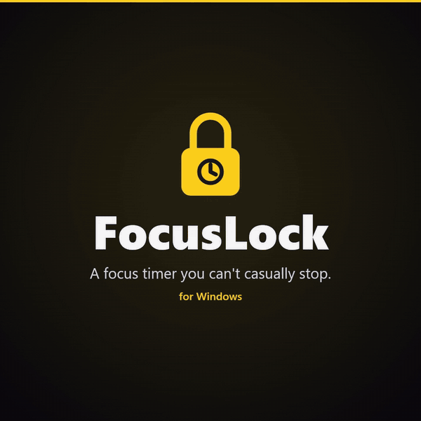

# FocusLock v1

A Windows focus timer you can't casually stop. While a session runs it:

- shows a countdown bar across the top of the screen (an AppBar, so windows can't cover it)
- covers browser tabs that look like entertainment with a dark overlay; if you stay on that tab, it closes it with Ctrl+W after 2 minutes
- kills blocked apps (Steam, Epic, etc.) wherever they're running
- lets music play in the background, but covers a music tab/app that sits in front for more than 60 seconds
- reads the active tab's **real URL** from the address bar (UI Automation, the accessibility API; no browser extension, no admin)
- optionally takes a **task** ("fix pagination bug") and covers anything unrelated to it, browser or app
- uses a **judge** for what the rules don't cover: Jev, a small local model (Ollama, LM Studio), or any OpenAI-compatible API

The only ways out are the timer ending or restarting the PC.

[](docs/focuslock-promo.mp4)

[Watch the 50-second promo (MP4)](docs/focuslock-promo.mp4)

## Build

Needs Go 1.24+ on Windows. One dependency: the GitHub Copilot SDK, for the `"copilot"` judge.

```
go build -ldflags "-s -w" -o focuslock.exe ./cmd/focuslock
```

The exe isn't in the repo; build it as above (from WSL: `GOOS=windows GOARCH=amd64 go build -ldflags "-s -w" -o focuslock.exe ./cmd/focuslock`).

## Use

```
focuslock start                                  opens the start window (below)
focuslock start 50m "fix pagination bug in API"  same window, pre-filled
focuslock start 50m "task" --no-prompt           start without the window
focuslock status
focuslock config                                 prints path to focus.json
focuslock judge-check ["task"]                   try the judge on a few sample pages (and list Copilot models)
focuslock judge-eval make                        turn your log into test cases to label
focuslock judge-eval                             score the judge on your labelled cases
```

### The start window

`focuslock start` opens a small window that asks:
- **How long?** (`50m`, `1h30m`, `45`)
- **What are you working on?** More detail helps the judge.
- **Sites this session needs**, besides `focus.json`: `portal.azure.com, dev.azure.com/myorg, console.aws.amazon.com`
- **Apps this session needs**: `Postman, docker desktop, ssms`

These extras apply to **this session only**. Your answers are remembered (`last-session.json`) and filled in next time. General settings (judge, block lists, rationing) stay in `focus.json`.

Keys: Ctrl+Enter (or Enter in the duration or apps box) starts, Tab moves between boxes, Esc cancels.

## A reminder to plan

The hardest part is remembering to start. With the cue on, FocusLock reminds you whenever no session is running:
- **A thin amber line** breathes slowly along the top of the screen, a quiet sign that no session is running, with a few **faint sparks** drifting down from it and fading out. Clicks pass straight through both. (`"particles": false` turns the sparks off.)
- **About a minute after you sign in, then every 45 minutes while you're idle,** a pill slides down from the top: *"▶ Plan your next focus session"*. Click it for the start window; × dismisses it until the next reminder. It slides away by itself after 20 seconds.
- It's **quiet during a session**, gives you a **5-minute break** after one, and stays out of the way while you're **presenting or full screen** and in **Do Not Disturb**. Set `workHours` if you also want it quiet at certain hours.

Turn it on once:
```
focuslock startup on       start the cue now (with a hello pill) and at every sign-in; just for your user, no admin
focuslock startup off      stop it, and don't start at sign-in
focuslock startup status
```
Settings, in `focus.json`:
```json
"cue": { "enabled": true, "line": true, "particles": true, "remindEveryMinutes": 45, "workHours": "",
         "weekdaysOnly": false, "afterSessionMinutes": 5, "startupDelaySeconds": 60 }
```
`workHours` is `""` (any time) by default; set it like `"09:00-19:00"`, or past midnight like `"22:00-02:00"`. Changes apply within a minute. Nothing is ever blocked while there's no session: the cue only nudges.

## Rationing email and chat

Outlook and Teams are fine for work, but checking them every five minutes isn't. With `"rations"`, each gets **check windows**:
```json
"rations": [
  { "name": "Email", "match": ["outlook.exe", "olk.exe", "outlook.office.com", "mail.google.com"],
    "everyMinutes": 30, "forMinutes": 5 },
  { "name": "Teams", "match": ["ms-teams.exe", "teams.exe", "teams.microsoft.com"],
    "everyMinutes": 20, "forMinutes": 5, "exceptTitleKeywords": ["meeting", "call", "sharing", "presenting"] }
]
```
(These are the defaults.)
- **Your first visit opens a window.** Coming back during it is free.
- **Afterwards it's covered** until the next window: *"Next check at 14:30 (in 12 min). You've gone to it 9 times this session."* The next window opens on your next visit once `everyMinutes` have passed.
- **Need it now?** Type why and it opens for `forMinutes`. That uses one of your explanations; no judge is involved, so it also works with `"provider": "none"`. It doesn't move the regular schedule.
- **Teams meetings and calls** (titles with "meeting", "call"...) are never covered. Check that your meeting windows' titles match, and add words to `exceptTitleKeywords` if not.
- `match` takes exe names and domains, so Outlook on the web is rationed too.
- Remove an entry, or set `"rations": []`, to turn it off.

## Multiple monitors

Every tick, FocusLock also checks the **window in front on each of your other monitors**, not just the one you're typing in:
- A blocked window there gets its own overlay, so a video on the second screen no longer slips through.
- They're **covered, never closed**: keys only reach the focused window.
- Click the overlay to bring that window to your current screen, where you can explain it.
- Music there is fine (it's in the background).
- Email on a side screen is visible only during a check window.
- Blocked apps (Steam...) are killed wherever they are, as before.

Limits:
- Only the **front** window per monitor is checked. Two windows side by side on one monitor: the one behind isn't.
- The top bar is on the main monitor only.
- With different scaling per monitor (say 150% and 100%), overlays on the other monitor may be slightly off. Not tested yet.

## Choosing a judge

Set `"judge": { "provider": ... }` in `focus.json`:

| provider | What | Setup |
|---|---|---|
| `"jev"` (default) | TypeSafe Jev, fast and cheap, real probabilities | `setx TYPESAFE_API_KEY your-key`, new terminal |
| `"openai"` | Any OpenAI-compatible chat API | Fill the `"openai"` section (below) |
| `"jevos"` | [jevos](https://github.com/feder-cr/jev), an open-source Jev on your own CPU. Free, and nothing leaves the machine | Download it (below) and set `"jevos": {"exe": ...}` |
| `"copilot"` | GitHub Copilot, through the Copilot CLI you're signed in to. Meant for the work laptop | `copilot` on PATH and signed in; pick a model (below) |
| `"none"` | Rules only; nothing leaves the machine | — |

**Local model with Ollama** (nothing leaves the machine):
```
ollama pull qwen2.5:3b
```
```json
"judge":  { "provider": "openai", ... },
"openai": { "baseUrl": "http://localhost:11434/v1", "model": "qwen2.5:3b", "jsonMode": true }
```
LM Studio: `"baseUrl": "http://localhost:1234/v1"`; if it rejects `response_format`, set `"jsonMode": false`.
A hosted API (OpenAI, Groq, OpenRouter...): set its `baseUrl` and `model`, and put the key in the env var named by `apiKeyEnv`.

`focuslock start` tells you which judge is active, and warns if a local server isn't reachable.

Small models (1–3B) are fine at "is this fun?" and decent at "is this my task?". If they misjudge too often, try a 7B model or raise `judge.threshold`. LLMs report their own confidence, which is rougher than Jev's probabilities.

**Copilot** (work laptop): FocusLock starts the Copilot CLI once and asks each question in a fresh session with **all tools off and every permission refused**, so the agent only reads the prompt and answers.
```json
"judge":   { "provider": "copilot", ... },
"copilot": { "model": "gpt-5-mini", "cliPath": "" }
```
- `cliPath` empty means `copilot` on PATH.
- **Every new tab or app judged is one Copilot request.** Answers are cached for the session, but pick a cheap or included model. `focuslock judge-check` lists your models with their premium-request cost.
- If your org has turned the Copilot CLI off, the judge can't start, and FocusLock runs on rules only.

**jevos** (local, free, private): an open-source Jev that runs on your CPU, about 1 GB of RAM, no GPU.
1. From the [jevos release](https://github.com/feder-cr/jev/releases/tag/jevos-v5), download `jev-windows-x64.zip` and `jevos-v5-openvino-int8.zip`.
2. Unzip the first, then unzip the model inside it, so you have `jev\jev.exe` and `jev\model\`.
3. In `focus.json`:
   ```json
   "judge": { "provider": "jevos", ... },
   "jevos": { "exe": "C:\\Tools\\jev\\jev.exe" }
   ```
   FocusLock starts `jev.exe` for each session (hidden), restarts it if it stops, and stops it afterwards. While it's down, strict sites stay covered. Leave `exe` empty if you run `jev.exe serve` yourself. `threads` defaults to half your CPU.
4. Run `focuslock judge-check`. If Windows blocks `jev.exe` (Smart App Control), it says so in the log.

How it judges: jevos speaks Jev's API but needs different questions. Tested on 86 decisions from real sessions, Jev's multiple-choice question scored 57% with it. Direct yes/no questions with your task written in ("Is this page about *your task*?", "Is it a general work tool?", "Is it entertainment?") scored **94%; Jev scored 95%** on the same cases. Answers take about 0.6 s. It's weaker than Jev at judging **explanations**: it reads only your reason and checks that it's about your task, so a reason that just names the topic can get through.

**Your task, spelled out.** With a judge that can write (Copilot, or an OpenAI-compatible model), `focuslock start` first asks it to describe your task in four lines: the goal, related topics, typical resources, and nearby topics that don't help. Every tab and app is then judged against that, which works much better than a one-line task. For example, *"my plan is work on building a windows service in C#…"* becomes:
```
Goal: Build a Windows service in C#.
Topics: Windows services, C#, service configuration and lifecycle
Resources: Documentation, tutorials, and search results about Windows services and C#
Not part of it: Unrelated C# topics or Windows development unrelated to services
```
- It's printed when the session starts and written to the log.
- The bar and the block screen still show your own wording.
- It adds one judge request (about 5 s) at start. If it fails, the task is used as written.
- Turn it off with `"judge": {"describeTask": false}`. Jev and jevos don't use it; jevos tested no better with it.

**Before a real session, run `focuslock judge-check`.** It shows which judge is active, asks it about four sample pages and prints the answers and timings. Then try `focuslock start 2` for a two-minute test.

## How a tab is judged

1. **URL rules** (browsers): `allowDomains`, then `searchDomains`, then `musicDomains`, then `blockDomains`.
   - **Web search results pages are always allowed** (`searchDomains`: DuckDuckGo, Google, Bing...). The page you open from them is judged. YouTube's results page isn't on the list, because it's a wall of videos. `youtube.com` matches `m.youtube.com` too; `youtube.com/shorts` matches only that path. Browser pages like `chrome://settings` are allowed.
2. Process lists: `blockedProcesses` -> killed, `musicProcesses` -> music. Other non-browser apps are allowed.
3. Browser title keywords, in order: `allowTitleKeywords`, then `musicTitleKeywords`, then `blockTitleKeywords`. `allowTitleKeywords` only count when the tab's address can't be read; otherwise `allowDomains` decides, so "docs" or "claude" in a YouTube title doesn't wave the video through.
4. **Strict sites** (`strictDomains`: youtube.com, x.com, twitter.com, reddit.com). These apply only when a judge is set:
   - A title that names only the site, like `YouTube - Brave`, `Home / X`, or a bare URL, is blocked without asking the judge. Browsers show these while a page loads, and on home or feed pages.
   - A page here is allowed only if the judge is at least `threshold` sure it's work or learning (or, with a task, on task). Unsure means **blocked** here, so a coin-flip "learning 0.55" on YouTube no longer passes.
   - While a new page on the same site is being judged, the overlay stays up instead of flickering off. It never closes a tab that hasn't been judged yet.
   - A placeholder title also has to settle first, so a video's brief `youtube.com/watch?v=... - Brave` title never flashes a block.
5. Anything else goes to the judge.
   - Without a task: work / learning / music / entertainment / social.
   - With a task: on_task / supporting / off_task / music / entertainment. Apps are judged too, except `alwaysAllowProcesses` (editors, terminals, Teams, Outlook...).
     - An app the judge isn't sure about is covered (`judge.strictApps`, on by default; set it to `false` to allow unsure apps). WhatsApp at "off_task 0.51" no longer slips through.
     - A page whose title is only the site's name ("Hello Interview") must be judged as surely on task, because there's nothing else to go on.
   - Browser pop-ups and bubbles (an "extension added" notice, a permission prompt) aren't judged. Installed web apps (YouTube as an app) still are.
   - It blocks only if the judge is at least `threshold` (0.75) sure. Unsure means allow (except on strict sites, above). Answers are cached, and things are allowed while the judge is still answering.
   - A title is judged only after it has stayed the same for `judge.settleMs` (1200 ms). Pages flip through placeholder titles while loading, and those used to get judged, giving answers that flipped a second later. Allow and block rules still apply instantly.
6. If the judge is unset: allowed. If it's set but not answering (no network, jevos stopped): strict sites are covered until it's back ("the judge isn't answering"), everything else is allowed.

The judge gets the **app**, the **window title**, the **domain + path** (for example `youtube.com/watch`) and your **task**. The `?query` part is never sent, since it can contain tokens or IDs. Set `"judge": {"sendUrl": false}` to send titles only. Every decision is written to the log.

**What gets blocked how:**
- Apps on `blockedProcesses`: killed.
- Browser tabs: overlay below the tab strip, then Ctrl+W after `closeTabAfterSeconds`.
- Other apps the judge flags (with a task): overlay only, title bar left free. They are **never killed or sent keys**, since they might hold unsaved work.

While you're typing in the address bar, FocusLock keeps using the last real URL, so half-typed text is never judged. If the URL can't be read (an unusual browser, for example), it falls back to title-only, as before.

## How good is your judge?

`focuslock judge-eval make` turns the judge's decisions in your log into `eval-cases.jsonl`, one per line. Set each `"label"` to `"A"` (should be allowed) or `"B"` (should be blocked); leave unsure ones empty. Then `focuslock judge-eval` runs the judge you've configured on them, through the real rules and thresholds. It prints:
- how many it got right
- every real-work page it blocked and every distraction it missed
- how fast it answered

Switch `judge.provider` and run it again to compare judges on your own browsing.

## Explaining a block

When the **judge** blocks something (not your block lists), the block screen has a box: *Need this for your task? Say why.*
- Type a specific reason and press Enter. The judge reads it together with the page and your task. Accepted means:
  - On strict sites (YouTube, X...): **that page** is allowed for the rest of the session. One good video doesn't unlock YouTube.
  - Elsewhere: **that site** is allowed. For an app: **that app**.
  - The reason becomes a **note for the session**. Every later question includes it, so the judge learns more about your task as you go.
- Vague reasons ("research", "just a minute") are turned down.
- You get **3 tries per session** (`explain.maxPerSession`); each try counts, accepted or not. If the judge fails to answer, the try doesn't count.
- While you type, and while the judge is reading, the tab's close countdown stops.
- Block lists, Shorts, and home or feed pages can't be explained away.
- Accepted notes are saved in `state.json`, so a restarted worker keeps them. Every explanation is logged.
- Turn it off with `"explain": {"enabled": false}`.

The block screen also shows what was blocked, who decided and how sure, your task, the countdown, and the session's stats.

## Work laptop mode

Set `"judge": { "provider": "copilot" }` so titles only go to Copilot, which your company already approved. Or use `"none"` (or a local Ollama model), so nothing leaves the machine. Put your company's tools in `allowDomains` (`atlassian.net`, `dev.azure.com` and similar are already there) and `alwaysAllowProcesses`.

Note: security software may flag an unsigned exe that kills processes and sends keystrokes. Check with IT before installing.

## Files

Everything lives in `%LOCALAPPDATA%\FocusLock\`:

| File | What |
|---|---|
| `focus.json` | All lists and settings. Edit freely; applies to the next session |
| `focuslock.log` | What got blocked and why, Jev answers, restarts |
| `state.json` | Current session: end time, boot time, task, this session's extra sites and apps, accepted explanations |
| `eval-cases.jsonl` | Test cases from `judge-eval make`, for you to label |
| `focuslock.log` (cue lines) | When the cue started and each reminder it showed |
| `last-session.json` | Your last answers in the start window, to pre-fill the next one |
| `focuslock-guard.exe`, `focuslock-worker.exe` | Copies of the exe that run the session |

## Why it's annoying to kill

`start` launches two processes under different names. The **worker** does the blocking and draws the windows. The **guard** has no window. Each one waits on the other and restarts it within about half a second if it dies. Killing `focuslock.exe` by name does nothing, and Task Manager is too slow to kill both.

**Emergency exit** (if something misbehaves): restart the PC, or run in one command:
```
taskkill /f /im focuslock-guard.exe /im focuslock-worker.exe
```

## Known v1 limits

- If the browser runs as admin, Windows won't let a normal process send it Ctrl+W.
- Fullscreen video or games can sit above the overlay. Blocked apps still get killed.
- Only the **active** tab of each browser window is checked.
- URL reading works best in Chrome, Edge, and Brave. Firefox falls back to the first text box it finds, which is usually the address bar.
- No hosts-file site blocking (that needs admin; v2 with the Windows Service).

## Architecture

FocusLock is split into packages by job. Everything that decides what's allowed is portable Go under `internal/`, built and tested on any OS. Only `cmd/focuslock` touches Windows.

```
cmd/focuslock          the Windows app (package main)
  ├─ internal/classify   decides each window: rules → explanations → judge
  │    └─ internal/judge   asks a judge (Jev, OpenAI-compatible, Copilot, jevos)
  ├─ internal/config     focus.json, and the start window's per-session setup
  ├─ internal/session    state.json: the running session
  ├─ internal/cue        when to remind you to plan a session
  └─ internal/particles  the cue's falling sparks (per-pixel drawing)
internal/logx, internal/textutil   logging and two tiny string helpers, used by all
```

Imports only point downward: `cmd` → `classify` → `judge` → `config`. Nothing in `internal/` imports the Windows code, so every decision can be tested without Windows. Each package starts with a `doc.go` that explains it; `go doc ./internal/classify` prints it.

**Following one tab through the code:**
1. Every 500 ms, `tick()` (`cmd/focuslock/ui_windows.go`) finds the window in front and reads its URL from the address bar (`uia_windows.go`).
2. It asks `classify.Classifier.Classify` (`internal/classify/classify.go`). Cheap rules go first (`rules.go`, `urls.go`, `titles.go`), then any explanations you gave (`explain.go`). Only then does it ask the judge.
3. The judge (`internal/judge`) gets a `Question` and returns an `Answer`. `Decide` (`verdict.go`) turns that into a `Verdict`: allow, block, or music. Each judge is one file that registers itself by name.
4. Back in `tick()`, a block becomes the overlay (`blockscreen_windows.go`). After the countdown, the tab gets Ctrl+W; a blocked app gets killed.
5. The same check runs for the front window on each other monitor (`monitors_windows.go`).

**Where to start reading:**
- `internal/judge/judge.go`: the `Judge` interface. Every judge implements just two methods, `Name` and `Ask`.
- `internal/classify/classify.go`: `Classify`, the decision pipeline in one function.
- `cmd/focuslock/ui_windows.go`: `tick()`, where it all comes together.

## Code map

| Package | Files | What's there |
|---|---|---|
| `cmd/focuslock` | `main_windows.go` | commands: start, status, config, judge-check, judge-eval |
| | `worker_windows.go` | the guard and worker that restart each other |
| | `setup_windows.go` | the start window |
| | `ui_windows.go` | the 500 ms monitor loop and the top bar |
| | `blockscreen_windows.go` | the overlay: what it says, the explain box, drawing |
| | `monitors_windows.go` | checking the front window on other monitors |
| | `uia_windows.go` | reading the address bar with UI Automation (COM) |
| | `jevos_windows.go` | starting and restarting `jev.exe` for a session |
| | `cue_windows.go` | the reminder: breathing line and sliding pill |
| | `startup_windows.go` | `startup on/off`: the per-user Run entry in the registry |
| | `winapi_windows.go` | Win32 calls through `syscall`, no dependencies |
| `internal/classify` | `classify.go` | the decision pipeline, settle delay, cache |
| | `rules.go`, `urls.go`, `titles.go` | domain, process and title rules; strict sites; placeholder titles; pop-ups |
| | `explain.go` | explaining a block; session notes |
| | `ration.go` | check windows for email and chat |
| | `eval.go` | `judge-eval`: score a judge on labelled cases from your log |
| `internal/judge` | `judge.go` | the `Judge` interface, optional extras, the registry |
| | `verdict.go` | `Category`, `Verdict`, and `Decide` (answer → verdict) |
| | `prompt.go` | the categories and the text prompt for LLM judges |
| | `jev.go`, `openai.go`, `copilot.go`, `jevos.go` | one file per judge |
| | `describe.go` | spelling out your task at session start |
| | `check.go` | `judge-check` |
| `internal/config` | `config.go`, `setup.go` | focus.json; the start window's per-session setup |
| `internal/session` | `state.go`, `boottime_*.go` | state.json; when Windows booted |
| `internal/cue` | `cue.go` | when to remind you to plan (a plain function, tested) |
| `internal/particles` | `particles.go` | the cue's falling sparks: simulation and per-pixel drawing (tested) |

Tests sit next to the code they test (`*_test.go`): `go test ./...`
